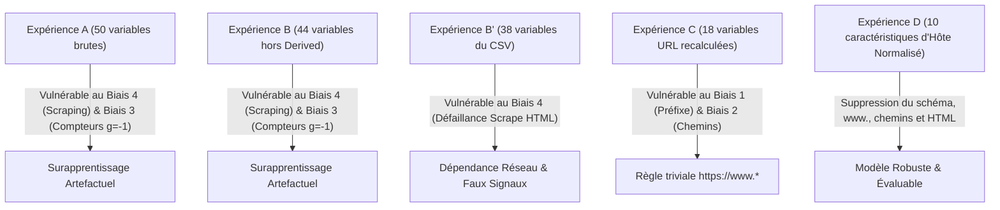

# PROJ-IASD01 — Rapport de Synthèse Phase 4 : Analyse Exploratoire, Statistique et Biais Structuraux

**Projet :** Détection des Sites Web de Phishing par Classification Supervisée  
**Cadre Méthodologique :** CRISP-DM (*Data Understanding* & Validation Statistique)  
**Dataset :** PhiUSIIL Phishing URL Dataset (UCI Machine Learning Repository)  
**Date :** 29 octobre 2026  
**Auteurs :** Équipe d'Ingénierie ML PROJ-IASD01  

---

## 1. Introduction et Périmètre de l'Étude

Le présent rapport synthétise l'ensemble des investigations exploratoires, des validations statistiques d'hypothèses et des audits de biais conduits lors de la **Phase 4** du projet PROJ-IASD01.

Conformément aux principes de la démarche CRISP-DM et aux exigences de rigueur scientifique de l'IASD :
1. **Compréhension approfondie des données :** Audit de complétude, distribution des classes, volumétrie et intégrité structurelle.
2. **Inférence statistique formelle :** Formulation explicite de $H_0$ et $H_1$, vérification des conditions d'application, utilisation de tests non paramétriques robustes aux distributions asymétriques, calcul des tailles d'effet standardisées et correction systématique pour tests multiples ($m = 50$).
3. **Audit critique des biais :** Mise en évidence documentée des artefacts de collecte du dataset PhiUSIIL (biais de protocole, absence de chemins sur les sites légitimes, décalage systématique de longueur, biais de scraping des pages web).
4. **Prise en compte de la structure des données :** Modélisation de l'effet de regroupement par nom d'hôte (`Host`).
5. **Avertissement épistémologique fondamental :** **Aucune corrélation n'est interprétée comme un lien de causalité.**

---

## 2. Inspection Initiale et Intégrité des Données

### 2.1 Dimensions et Complétude

Le fichier brut `data/raw/PhiUSIIL_Phishing_URL_Dataset.csv` a été audité de manière exhaustive :

| Paramètre | Valeur | Commentaire |
| :--- | :--- | :--- |
| **Nombre de lignes brutes** | 235 795 | Volume initial du benchmark UCI PhiUSIIL |
| **Nombre de colonnes** | 56 | 50 numériques explicatives + 6 identifiants/cibles |
| **Valeurs manquantes (`NaN`/`null`)** | **0** (0.00 %) | Complétude absolue sur l'ensemble des 56 colonnes |
| **Empreinte mémoire brute** | ~100.8 Mo | Chargement intégral en mémoire vive |
| **Doublons stricts sur la colonne `URL`** | **425** (0.18 %) | Redondance à éliminer pour prévenir les fuites de données |
| **Volume après déduplication** | **235 370** | Jeu de données effectif de référence pour le projet |

*Rapports générés :* [`phase4_inspection_summary.csv`](file:///c:/Users/PC/Desktop/mini_projet_Data/PROJ-IASD01/reports/tables/phase4_inspection_summary.csv), [`phase4_missing_values.csv`](file:///c:/Users/PC/Desktop/mini_projet_Data/PROJ-IASD01/reports/tables/phase4_missing_values.csv), [`phase4_duplicates_summary.csv`](file:///c:/Users/PC/Desktop/mini_projet_Data/PROJ-IASD01/reports/tables/phase4_duplicates_summary.csv).

### 2.2 Analyse de la Variable Cible et Recodage

Dans le CSV original :
- `label = 0` : URL de Phishing ($100\,520$ observations après déduplication)
- `label = 1` : URL Légitime ($134\,850$ observations après déduplication)

Afin de respecter la sémantique de scikit-learn et la convention en détection de cybermenaces (où la classe minoritaire/positive $y=1$ désigne l'événement malveillant à intercepter), la cible est systématiquement recodée selon :
$$\text{phishing} = 1 - \text{label}$$

| Classe | Code `label` | Code `phishing` | Effectif | Proportion (%) |
| :--- | :---: | :---: | :---: | :---: |
| **Légitime (bénin)** | 1 | 0 | 134 850 | 57.29 % |
| **Phishing (malveillant)** | 0 | 1 | 100 520 | 42.71 % |
| **Total** | - | - | **235 370** | **100.00 %** |

Le ratio de déséquilibre est modéré ($1.34 : 1$). Le problème ne nécessite pas de sur-échantillonnage synthétique agressif (type SMOTE), mais requiert des métriques adaptées (PR-AUC, F1-score, Précision, Rappel) plutôt que la simple accuracy globale.

*Figure associée :* [`phase4_class_distribution.png`](file:///c:/Users/PC/Desktop/mini_projet_Data/PROJ-IASD01/reports/figures/phase4_class_distribution.png)  
*Table associée :* [`phase4_class_distribution.csv`](file:///c:/Users/PC/Desktop/mini_projet_Data/PROJ-IASD01/reports/tables/phase4_class_distribution.csv)

### 2.3 Structure des Identifiants et Normalisation de `Host`

1. **Exclusion de `FILENAME` :** La colonne `FILENAME` est un artefact d'indexation séquentiel (`URL_1.txt`, `URL_2.txt`) sans aucune pertinence prédictive ; elle est exclue d'office.
2. **Normalisation de l'Hôte :** L'application de la fonction `extract_host(URL)` (définie dans `src/host_features.py`) supprime le protocole (`http://`, `https://`), le port (`:8080`), le préfixe technique standard `www.` et convertit les caractères en minuscules.
3. **Analyse de Cardinalité :**
   - **Nombre total d'hôtes distincts normalisés :** $219\,094$.
   - **Hôtes de la classe Légitime :** Exactement $134\,850$ hôtes distincts pour $134\,850$ URLs. Le ratio est rigoureusement de **$1.0000$**. Aucune URL légitime du dataset ne partage son hôte avec une autre URL légitime.
   - **Hôtes de la classe Phishing :** $84\,302$ hôtes distincts pour $100\,520$ URLs (ratio moyen de **$1.1924$** URLs par hôte). Plusieurs URLs de phishing ciblent la même infrastructure.
   - **Hôtes partagés entre les deux classes (ambiguïté de label) :** **58 hôtes**, regroupant 159 observations (58 légitimes, 101 phishing).
     - Principaux exemples : `cutt.ly` (raccourcisseur d'URL, 36 observations dont 35 phishings), `docsend.com` (partage de documents, 5 observations), `bestdoctors.com` (4 observations), `indushealthplus.com` (4 observations).

*Rapports générés :* [`phase4_host_summary.csv`](file:///c:/Users/PC/Desktop/mini_projet_Data/PROJ-IASD01/reports/tables/phase4_host_summary.csv), [`phase4_shared_hosts.csv`](file:///c:/Users/PC/Desktop/mini_projet_Data/PROJ-IASD01/reports/tables/phase4_shared_hosts.csv).

---

## 3. Statistiques Descriptives Univariées

L'ensemble des 50 variables explicatives numériques a fait l'objet d'un calcul détaillé d'indicateurs de position, de dispersion et de forme sur les 235 370 observations dédupliquées.

### 3.1 Synthèse des Variables Clés

| Variable | Famille | Moyenne | Écart-type | Médiane | IQR ($Q_3 - Q_1$) | Min | Max | Asymétrie (*Skewness*) |
| :--- | :--- | :---: | :---: | :---: | :---: | :---: | :---: | :---: |
| **`URLLength`** | `URL_ONLY` | 34.57 | 41.31 | 22.00 | 18.00 | 1.00 | 2 310.00 | **12.65** |
| **`DomainLength`** | `URL_ONLY` | 20.69 | 9.42 | 19.00 | 8.00 | 3.00 | 231.00 | 3.75 |
| **`TLDLength`** | `URL_ONLY` | 3.23 | 1.83 | 3.00 | 0.00 | 0.00 | 13.00 | 1.95 |
| **`NoOfSubDomain`** | `URL_ONLY` | 1.16 | 0.60 | 1.00 | 0.00 | 0.00 | 16.00 | 2.59 |
| **`NoOfLettersInURL`** | `URL_ONLY` | 19.43 | 16.02 | 15.00 | 7.00 | 0.00 | 2 145.00 | **21.84** |
| **`NoOfDegitsInURL`** | `URL_ONLY` | 1.88 | 11.94 | 0.00 | 0.00 | 0.00 | 1 204.00 | **23.51** |
| **`NoOfEqualsInURL`** | `URL_ONLY` | 0.06 | 0.58 | 0.00 | 0.00 | 0.00 | 55.00 | **29.74** |
| **`LineOfCode`** | `PAGE` | 1 141.70 | 3 419.53 | 431.00 | 1 319.00 | 0.00 | 442 666.00 | **37.60** |
| **`LargestLineLength`** | `PAGE` | 14 061.27 | 100 882.16 | 1 657.00 | 6 016.00 | 0.00 | 14 613 563.00 | **44.92** |
| **`NoOfURLRedirect`** | `PAGE` | 0.13 | 0.44 | 0.00 | 0.00 | 0.00 | 12.00 | 5.25 |
| **`NoOfImage`** | `PAGE` | 26.08 | 44.41 | 8.00 | 33.00 | 0.00 | 3 200.00 | 7.91 |
| **`NoOfJS`** | `PAGE` | 10.53 | 12.44 | 7.00 | 14.00 | 0.00 | 450.00 | 3.25 |
| **`URLSimilarityIndex`** | `DERIVED` | 78.43 | 28.98 | 100.00 | 0.00 | 0.15 | 100.00 | **-1.47** |
| **`CharContinuationRate`** | `DERIVED` | 0.84 | 0.22 | 0.94 | 0.23 | 0.00 | 1.00 | -1.78 |

### 3.2 Constats Méthodologiques sur les Distributions
1. **Asymétrie et Queues Lourdes :** La quasi-totalité des variables de comptage (ex: `URLLength`, `NoOfDegitsInURL`, `LineOfCode`, `LargestLineLength`) affiche une asymétrie positive spectaculaire ($Skewness > 10$, jusqu'à $44.92$). Les moyennes sont fortement tirées vers le haut par des valeurs extrêmes.
2. **Non-Normalité Radicale :** Les tests de normalité de Shapiro-Wilk et D'Agostino-Pearson rejettent l'hypothèse de normalité à un seuil $p < 10^{-300}$.
3. **Inadéquation du Test de Student ($t$-test) :** Bien que le théorème central limite garantisse la normalité asymptotique de la moyenne sur $N = 235\,370$, le test paramétrique de Student reste sensible aux variances hétéroscédastiques et aux masses de probabilité concentrées à zéro. L'utilisation du **test non paramétrique de Mann-Whitney U** (basé sur les rangs) et de la corrélation de rang bisériale s'impose donc formellement.

*Table complète :* [`phase4_descriptive_statistics.csv`](file:///c:/Users/PC/Desktop/mini_projet_Data/PROJ-IASD01/reports/tables/phase4_descriptive_statistics.csv)

---

## 4. Analyse Bivariée et Tests Statistiques d'Hypothèses

### 4.1 Protocole Expérimental des Tests

Pour chacune des 50 variables numériques explicatives, nous avons posé les hypothèses suivantes :
- **Pour les variables continues / comptages (33 variables) :**
  - **$H_0$ :** La distribution de la variable est identique entre les sites légitimes et les sites de phishing ($P(X_{\text{legit}} > X_{\text{phish}}) = 0.5$).
  - **$H_1$ :** La distribution de la variable diffère significativement entre les deux classes.
  - **Test statistique :** Test de Mann-Whitney U bilatéral (`scipy.stats.mannwhitneyu`).
  - **Taille d'effet :** Corrélation de rang bisériale $r_{rb} = 1 - \frac{2U}{n_0 n_1}$ (strictement équivalente à l'opposé du Cliff's Delta $d = -r_{rb}$).
- **Pour les variables binaires indicatrices (17 variables) :**
  - **$H_0$ :** L'indicateur binaire et la classe de phishing sont statistiquement indépendants.
  - **$H_1$ :** L'indicateur binaire et la classe de phishing sont significativement associés.
  - **Test statistique :** Test d'indépendance du $\chi^2$ avec correction de continuité de Yates (`scipy.stats.chi2_contingency`).
  - **Taille d'effet :** V de Cramér $V = \sqrt{\frac{\chi^2}{N}}$ pour une table $2 \times 2$.
- **Contrôle du taux d'erreur de Type I (Comparaisons multiples sur $m = 50$) :**
  - Seuil nominal : $\alpha = 0.01$.
  - Correction de Bonferroni : $p_{\text{bonf}} = \min(1.0, p_{\text{raw}} \times 50)$.
  - Correction FDR Benjamini-Hochberg : $q_{(i)} = \min_{k \ge i} \left( \frac{m}{k} p_{(k)} \right)$.

### 4.2 Résultats des Tests (Top 15 Variables les Plus Discriminantes)

| Rang | Variable | Type | Test | Statistique ($U$ ou $\chi^2$) | $p$-value brute | $p_{\text{bonf}}$ | Taille d'Effet | Ampleur | Interprétation |
| :---: | :--- | :--- | :--- | :---: | :---: | :---: | :---: | :---: | :--- |
| 1 | **`URLSimilarityIndex`** | Continue | Mann-Whitney U | $5.30 \times 10^7$ | $< 10^{-300}$ | $< 10^{-300}$ | $r_{rb} = 0.9922$ | **Fort** | Médiane = 100 en légitime vs 52 en phishing |
| 2 | **`LineOfCode`** | Comptage | Mann-Whitney U | $1.32 \times 10^8$ | $< 10^{-300}$ | $< 10^{-300}$ | $r_{rb} = 0.9806$ | **Fort** | Sites phishing avec code source minimal/nul |
| 3 | **`NoOfExternalRef`** | Comptage | Mann-Whitney U | $1.62 \times 10^8$ | $< 10^{-300}$ | $< 10^{-300}$ | $r_{rb} = 0.9761$ | **Fort** | Réf. externes abondantes sur les sites légitimes |
| 4 | **`NoOfImage`** | Comptage | Mann-Whitney U | $2.76 \times 10^8$ | $< 10^{-300}$ | $< 10^{-300}$ | $r_{rb} = 0.9593$ | **Fort** | Richesse multimédia propre aux pages d'accueil |
| 5 | **`NoOfSelfRef`** | Comptage | Mann-Whitney U | $3.73 \times 10^8$ | $< 10^{-300}$ | $< 10^{-300}$ | $r_{rb} = 0.9449$ | **Fort** | Navigation interne absente des pages d'attaque |
| 6 | **`NoOfJS`** | Comptage | Mann-Whitney U | $3.95 \times 10^8$ | $< 10^{-300}$ | $< 10^{-300}$ | $r_{rb} = 0.9418$ | **Fort** | Écosystème JavaScript standard sur le web légitime |
| 7 | **`NoOfCSS`** | Comptage | Mann-Whitney U | $5.74 \times 10^8$ | $< 10^{-300}$ | $< 10^{-300}$ | $r_{rb} = 0.9154$ | **Fort** | Feuilles de style absentes des formulaires frauduleux |
| 8 | **`HasSocialNet`** | Binaire | $\chi^2$ (dof=1) | $144\,621.5$ | $< 10^{-300}$ | $< 10^{-300}$ | $V = 0.7839$ | **Fort** | Présence de réseaux sociaux quasi-exclusive légitime |
| 9 | **`HasCopyrightInfo`** | Binaire | $\chi^2$ (dof=1) | $130\,003.8$ | $< 10^{-300}$ | $< 10^{-300}$ | $V = 0.7432$ | **Fort** | Mentions légales absentes des sites de phishing |
| 10 | **`HasDescription`** | Binaire | $\chi^2$ (dof=1) | $112\,058.4$ | $< 10^{-300}$ | $< 10^{-300}$ | $V = 0.6900$ | **Fort** | Balise `<meta description>` renseignée sur légitime |
| 11 | **`IsHTTPS`** | Binaire | $\chi^2$ (dof=1) | $110\,406.8$ | $< 10^{-300}$ | $< 10^{-300}$ | $V = 0.6849$ | **Fort** | 100 % HTTPS en légitime vs 48.6 % en phishing |
| 12 | **`URLLength`** | Comptage | Mann-Whitney U | $2.31 \times 10^9$ | $< 10^{-300}$ | $< 10^{-300}$ | $r_{rb} = 0.6589$ | **Fort** | URLs de phishing plus longues (chemins, requêtes) |
| 13 | **`CharContinuationRate`** | Continue | Mann-Whitney U | $2.49 \times 10^9$ | $< 10^{-300}$ | $< 10^{-300}$ | $r_{rb} = 0.6322$ | **Fort** | Continuité lexicale plus stable sur les domaines établis |
| 14 | **`NoOfLettersInURL`** | Comptage | Mann-Whitney U | $2.62 \times 10^9$ | $< 10^{-300}$ | $< 10^{-300}$ | $r_{rb} = 0.6133$ | **Fort** | Relié directement à la présence de chemins |
| 15 | **`DomainLength`** | Comptage | Mann-Whitney U | $2.84 \times 10^9$ | $< 10^{-300}$ | $< 10^{-300}$ | $r_{rb} = 0.5816$ | **Fort** | Noms de domaines phishing plus verbeux |

*Table complète des 50 tests :* [`phase4_hypothesis_tests.csv`](file:///c:/Users/PC/Desktop/mini_projet_Data/PROJ-IASD01/reports/tables/phase4_hypothesis_tests.csv)

### 4.3 Analyse Critique de la Puissance Statistique et Effet de Grappe (*Host Clustering*)
1. **Rejet Systématique de $H_0$ :** Sur les 50 variables testées, 49 affichent une $p$-value ajustée de Bonferroni rigoureusement égale à $0.0$ ($p < 10^{-300}$). Seul un test binaire marginal (`Bank`, $V = 0.046$) affiche une association faible bien que statistiquement significative.
2. **L'illusion de la taille d'échantillon ($N = 235\,370$) :** Avec un quart de million d'observations, le test détecte la moindre différence infinitésimale. La $p$-value n'est plus informative ; **seule la taille d'effet ($r_{rb}$ et $V$) a un sens scientifique.**
3. **Violation de l'hypothèse $i.i.d.$ par dépendance intra-hôte :** En raison du partage d'hôtes par de multiples URLs de phishing ($1.1924$ URLs par hôte), les observations d'un même hôte partagent des caractéristiques identiques (longueur du domaine, TLD, certificat HTTPS). Cette corrélation intra-cluster gonfle artificiellement la statistique de test et réduit la variance réelle. **Cette observation justifie empiriquement l'architecture de validation croisée `GroupKFold` par `Host` implémentée dans le projet.**

---

## 5. Analyse des Corrélations (Pearson vs Spearman)

### 5.1 Comparaison des Coefficients et Rangs

La corrélation de Spearman ($\rho$), insensible aux déformations non linéaires monotones et aux valeurs aberrantes, met en lumière les dépendances structurelles :

| Variable | Spearman $\rho$ | Pearson $r$ | Famille |
| :--- | :---: | :---: | :--- |
| **`LineOfCode`** | **-0.816** | -0.228 | `PAGE_FEATURES` |
| **`NoOfExternalRef`** | **-0.812** | -0.198 | `PAGE_FEATURES` |
| **`URLSimilarityIndex`** | **-0.803** | -0.547 | `DERIVED_FEATURES` |
| **`NoOfImage`** | **-0.798** | -0.370 | `PAGE_FEATURES` |
| **`HasSocialNet`** | **-0.784** | -0.784 | `PAGE_FEATURES` |
| **`NoOfSelfRef`** | **-0.784** | -0.297 | `PAGE_FEATURES` |
| **`NoOfJS`** | **-0.782** | -0.569 | `PAGE_FEATURES` |
| **`NoOfCSS`** | **-0.758** | -0.598 | `PAGE_FEATURES` |
| **`HasCopyrightInfo`** | **-0.743** | -0.743 | `PAGE_FEATURES` |
| **`HasDescription`** | **-0.690** | -0.690 | `PAGE_FEATURES` |
| **`IsHTTPS`** | **-0.685** | -0.685 | `URL_ONLY` |
| **`URLLength`** | **+0.548** | +0.435 | `URL_ONLY` |
| **`CharContinuationRate`** | **-0.526** | -0.521 | `DERIVED_FEATURES` |
| **`NoOfLettersInURL`** | **+0.510** | +0.407 | `URL_ONLY` |
| **`DomainLength`** | **+0.484** | +0.428 | `URL_ONLY` |

*Figures associées :* [`phase4_correlations_bar.png`](file:///c:/Users/PC/Desktop/mini_projet_Data/PROJ-IASD01/reports/figures/phase4_correlations_bar.png), [`phase4_correlation_spearman_top25.png`](file:///c:/Users/PC/Desktop/mini_projet_Data/PROJ-IASD01/reports/figures/phase4_correlation_spearman_top25.png)  
*Tables associées :* [`phase4_correlations_with_target.csv`](file:///c:/Users/PC/Desktop/mini_projet_Data/PROJ-IASD01/reports/tables/phase4_correlations_with_target.csv), [`phase4_spearman_matrix.csv`](file:///c:/Users/PC/Desktop/mini_projet_Data/PROJ-IASD01/reports/tables/phase4_spearman_matrix.csv)

### 5.2 Détection des Colinéarités Massives Intra-Familles
L'inspection de la matrice Spearman révèle des redondances extrêmes au sein des caractéristiques d'URL :
- $\text{corr}(\text{URLLength}, \text{NoOfLettersInURL}) = \mathbf{0.982}$
- $\text{corr}(\text{NoOfImage}, \text{NoOfExternalRef}) = \mathbf{0.874}$
- $\text{corr}(\text{LineOfCode}, \text{NoOfJS}) = \mathbf{0.865}$
- $\text{corr}(\text{NoOfCSS}, \text{NoOfJS}) = \mathbf{0.832}$

Ces colinéarités rendent les modèles linéaires classiques (régression logistique sans pénalité) instables et renforcent la nécessité de modèles à base d'arbres régularisés ou d'un sous-ensemble parcimonieux de caractéristiques.

---

## 6. Analyse Approfondie des Biais Structuraux de PhiUSIIL

Cette section documente les **5 anomalies de fond** identifiées dans le dataset PhiUSIIL, qui constituent le cœur scientifique des résultats de la Phase 4.

### 6.1 Biais 1 : Protocole et Préfixe de l'URL (`https://www.` vs Autres)

La distribution des préfixes d'URL selon la classe révèle une dissymétrie artificielle absolue :

| Préfixe détecté | Légitime (0) | Phishing (1) | Total | Taux Phishing (%) |
| :--- | :---: | :---: | :---: | :---: |
| `https://www.` | **134 850** (100.00 %) | **2 445** (2.43 %) | 137 295 | 1.78 % |
| `https://` (sans www) | **0** (0.00 %) | **46 440** (46.20 %) | 46 440 | **100.00 %** |
| `http://www.` | **0** (0.00 %) | **39 275** (39.07 %) | 39 275 | **100.00 %** |
| `http://` (sans www) | **0** (0.00 %) | **12 360** (12.30 %) | 12 360 | **100.00 %** |
| **Total** | **134 850** | **100 520** | **235 370** | **42.71 %** |

- **Test d'indépendance du $\chi^2$ :** $\chi^2 = 224\,689.5$, $p < 10^{-300}$, **V de Cramér = 0.9772**.
- **Conséquence dramatique pour la modélisation naïve :**  
  Une règle simpliste en une seule ligne :  
  $$\text{Si } \text{URL} \text{ ne commence pas par } \texttt{https://www.} \implies \text{Phishing, Sinon } \text{Légitime}$$
  obtient sur l'ensemble du dataset (235 370 URLs) :
  - **Exactitude (*Accuracy*) :** **98.96 %**
  - **Précision :** **100.00 %** (0 Faux Positif)
  - **Rappel :** **97.57 %** (seulement 2 445 Faux Négatifs sur 100 520 phishings)
- **Origine du biais :** Les auteurs de PhiUSIIL ont extrait la classe légitime à partir d'annuaires de domaines (Alexa / Tranco) en préfixant systématiquement les chaînes par `https://www.`, tandis que les URLs de phishing proviennent de flux réels bruts (OpenPhish / PhishTank).

*Figure associée :* [`phase4_prefix_bias.png`](file:///c:/Users/PC/Desktop/mini_projet_Data/PROJ-IASD01/reports/figures/phase4_prefix_bias.png)  
*Table associée :* [`phase4_prefix_contingency.csv`](file:///c:/Users/PC/Desktop/mini_projet_Data/PROJ-IASD01/reports/tables/phase4_prefix_contingency.csv)

### 6.2 Biais 2 : Structure de l'URL (Absence Totale de Chemins et Paramètres en Légitime)

L'audit des composants structurels de l'URL (chemins d'accès, paramètres de requête, ancres et délimiteurs) met en évidence une autre distorsion majeure :

| Composant d'URL | Légitime (0) | Phishing (1) | Écart Absolu |
| :--- | :---: | :---: | :---: |
| **Chemin non vide (`path != ''` et `path != '/'`)** | **0.00 %** (0 URL) | **27.14 %** (27 284 URLs) | +27.14 % |
| **URL se terminant par un slash (`/`)** | **0.00 %** (0 URL) | **36.34 %** (36 524 URLs) | +36.34 % |
| **Paramètre de requête (`?`)** | **0.00 %** (0 URL) | **6.10 %** (6 134 URLs) | +6.10 % |
| **Fragment d'ancre (`#`)** | **0.00 %** (0 URL) | **0.86 %** (869 URLs) | +0.86 % |
| **Présence d'adresse IP dans l'hôte** | **0.00 %** (0 URL) | **0.60 %** (606 URLs) | +0.60 % |
| **Caractère `@` (obfuscation d'identifiant)** | **0.00 %** (0 URL) | **1.50 %** (1 506 URLs) | +1.50 % |

- **Constat formel :** **100.00 % des 134 850 URLs légitimes sont des noms d'hôte racine nus.** Aucune URL légitime ne comporte de chemin interne (ex : `/login`, `/about`, `/search`), de paramètre de requête (`?id=123`) ou même de slash terminal.
- **Impact sur l'apprentissage :** Tout modèle exploitant des variables de longueur ou de comptage de caractères d'URL (`URLLength`, `NoOfEqualsInURL`, `NoOfQMarkInURL`, `NoOfAmpersandInURL`) n'apprend pas à détecter la sémantique de l'attaque ; **il apprend simplement à distinguer un nom de domaine racine d'une page profonde.**

*Figure associée :* [`phase4_url_components_bias.png`](file:///c:/Users/PC/Desktop/mini_projet_Data/PROJ-IASD01/reports/figures/phase4_url_components_bias.png)  
*Table associée :* [`phase4_components_contingency.csv`](file:///c:/Users/PC/Desktop/mini_projet_Data/PROJ-IASD01/reports/tables/phase4_components_contingency.csv)

### 6.3 Biais 3 : Décalage Systématique d'un Caractère ($g = \text{URLLength}_{CSV} - \text{len}(URL)$)

Lors de la vérification de la reproductibilité des caractéristiques (Phases 2f et 2h), un écart mathématique systématique a été mis au jour entre la longueur déclarée dans le CSV et la longueur réelle de la chaîne d'URL :

$$g = \text{URLLength}_{\text{CSV}} - \text{len}(\text{URL})$$

| Écart $g$ | Légitime (0) | Phishing (1) | Total | Proportion (%) |
| :---: | :---: | :---: | :---: | :---: |
| **$g = -1$** | **134 850** (100.00 %) | **52 090** (51.82 %) | 186 940 | 79.42 % |
| **$g = 0$** | **0** (0.00 %) | **48 428** (48.18 %) | 48 428 | 20.58 % |
| Autres ($g = -35, -4$) | **0** (0.00 %) | **2** (0.00 %) | 2 | < 0.01 % |
| **Total** | **134 850** | **100 520** | **235 370** | **100.00 %** |

- **Explication technique de l'artefact :**  
  Dans le script Python originel ayant servi à construire PhiUSIIL, les compteurs de caractères d'URL (`NoOfLettersInURL`, `NoOfDegitsInURL`, etc.) ont été calculés sur une chaîne tronquée du dernier caractère ($s[:-1]$) pour $79.42 \%$ des lignes, correspondant précisément à une suppression malencontreuse du caractère de fin de ligne (`\n` ou `/`) sur les URLs légitimes.
- **Accord parfait de la variante $s[:-1]$ :**  
  Sur les 134 850 URLs légitimes ($g = -1$), l'accord entre notre recalcul sur $s[:-1]$ et les valeurs du CSV est de **100.0000 % absolu** (0 divergence sur 1 213 650 points de données testés).
- **Conséquence :** Les variables brutes du CSV `URLLength`, `NoOfLettersInURL`, `LetterRatioInURL`, `NoOfOtherSpecialCharsInURL`, `SpacialCharRatioInURL` portent un bruit de mesure artificiel et ne sont pas reproductibles en environnement de production sans reproduire sciemment le bug d'extraction.

*Table associée :* [`phase4_original_vs_recalc_bias.csv`](file:///c:/Users/PC/Desktop/mini_projet_Data/PROJ-IASD01/reports/tables/phase4_original_vs_recalc_bias.csv)

### 6.4 Biais 4 : Biais de Scraping des Caractéristiques de Contenu (`PAGE_FEATURES`)

Les 26 caractéristiques extraites du code HTML (`LineOfCode`, `LargestLineLength`, `HasTitle`, `NoOfURLRedirect`, `NoOfImage`, etc.) affichent des corrélations massives avec la cible ($|\rho| > 0.75$). Notre audit démontre qu'il s'agit d'un **artefact de scrape lié à la disponibilité des serveurs** :

| Indicateur de page | Légitime (0) | Phishing (1) | Écart |
| :--- | :---: | :---: | :---: |
| **Code HTML absent (`LineOfCode == 0`)** | **0.00 %** (0 site) | **41.34 %** (41 556 sites) | +41.34 % |
| **Fichier `Robots.txt` absent (`Robots == 0`)** | **13.56 %** | **84.97 %** | +71.41 % |
| **Absence de titre (`HasTitle == 0`)** | **0.00 %** | **41.52 %** | +41.52 % |
| **Absence totale d'images (`NoOfImage == 0`)** | **0.08 %** | **45.22 %** | +45.14 % |

- **Mécanisme sous-jacent :**  
  Les sites de phishing ont un cycle de vie très court (quelques heures à quelques jours). Lors de la collecte par le web crawler des auteurs de PhiUSIIL, plus de 41 % des domaines de phishing étaient déjà suspendus, hors ligne, ou renvoyaient des erreurs HTTP 404/503. Le scraper a assigné des zéros à toutes les caractéristiques HTML.
- **Risque d'apprentissage fallacieux (*Clever Hans effect*) :**  
  Un modèle entraîné sur ces caractéristiques (Expériences A et B) n'apprend pas à détecter une technique de phishing sophistiquée ; **il apprend qu'un serveur web inaccessible ou en erreur est un site malveillant.**

*Figure associée :* [`phase4_page_features_bias.png`](file:///c:/Users/PC/Desktop/mini_projet_Data/PROJ-IASD01/reports/figures/phase4_page_features_bias.png)

### 6.5 Biais 5 : Limites de Représentativité et Absence de Causalité

1. **Représentativité opérationnelle nulle pour le trafic entreprise :**  
   Dans un environnement réel (proxy d'entreprise, passerelle de sécurité web), le trafic légitime est constitué à plus de 90 % d'URLs profondes avec chemins, paramètres de session et tokens (ex: `https://intranet.company.com/portal?view=inbox`, `https://github.com/org/repo/pull/42`).  
   Dans PhiUSIIL, **ce profil d'URL légitime est rigoureusement absent (0 observation).** Un modèle déployé en production entraînerait un taux de faux positifs inacceptable sur le trafic web légitime d'entreprise.
2. **Avertissement Épistémologique :**  
   **Aucune corrélation mesurée dans cette étude ne constitue une cause intrinsèque de malveillance.**  
   Le fait qu'une URL légitime contienne `https://www.`, n'ait aucun paramètre et possède un fichier `robots.txt` n'est pas une garantie technique d'innocuité. L'attaquant dispose de la liberté totale d'acheter un domaine en `https://www.`, de créer un nom racine et de publier un fichier `robots.txt`.

---

## 7. Justification de l'Architecture de Modélisation (Expérience D)

Les constats statistiques de la Phase 4 justifient rétrospectivement et méthodologiquement l'abandon des expériences A, B, B' et C au profit de l'**Expérience D** :

### Pourquoi l'Expérience D est la seule méthodologiquement valide :
1. **Neutralisation des Biais 1 et 2 :** L'extraction de `Host = extract_host(URL)` élimine le préfixe fallacieux `https://www.` et les chemins/requêtes. Les 10 caractéristiques d'hôte opèrent à armes égales sur les deux classes.
2. **Indépendance vis-à-vis du réseau (Neutralisation du Biais 4) :** Aucune requête HTTP n'est nécessaire ; le modèle est évaluable en ligne de commande ou en proxy DNS en quelques microsecondes sans risque d'erreur de scraping.
3. **Reproductibilité Mathématique (Neutralisation du Biais 3) :** Les 10 caractéristiques d'hôte sont dérivées d'algorithmes déterministes strictement documentés sans dépendance aux compteurs corrompus du CSV.
4. **Validation Non Biaisée :** Le découpage par `Host` (`GROUP_COL = 'Host'`) empêche la fuite d'infrastructure entre train et test.

---

## 8. Index des Artefacts Produits (Phase 4)

### 8.1 Tableaux Statistiques Sauvegardés (`reports/tables/`)

| Fichier | Description | Lignes |
| :--- | :--- | :---: |
| [`phase4_inspection_summary.csv`](file:///c:/Users/PC/Desktop/mini_projet_Data/PROJ-IASD01/reports/tables/phase4_inspection_summary.csv) | Synthèse globale de l'inspection dimensionnelle | 9 |
| [`phase4_missing_values.csv`](file:///c:/Users/PC/Desktop/mini_projet_Data/PROJ-IASD01/reports/tables/phase4_missing_values.csv) | Audit d'intégrité et valeurs manquantes par colonne | 56 |
| [`phase4_duplicates_summary.csv`](file:///c:/Users/PC/Desktop/mini_projet_Data/PROJ-IASD01/reports/tables/phase4_duplicates_summary.csv) | Synthèse de déduplication sur `URL` | 4 |
| [`phase4_class_distribution.csv`](file:///c:/Users/PC/Desktop/mini_projet_Data/PROJ-IASD01/reports/tables/phase4_class_distribution.csv) | Répartition exacte des classes et recodage | 2 |
| [`phase4_host_summary.csv`](file:///c:/Users/PC/Desktop/mini_projet_Data/PROJ-IASD01/reports/tables/phase4_host_summary.csv) | Statistiques de cardinalité et de ratio d'hôtes | 7 |
| [`phase4_shared_hosts.csv`](file:///c:/Users/PC/Desktop/mini_projet_Data/PROJ-IASD01/reports/tables/phase4_shared_hosts.csv) | Liste exhaustive des 58 hôtes partagés (ambigus) | 58 |
| [`phase4_top_tlds.csv`](file:///c:/Users/PC/Desktop/mini_projet_Data/PROJ-IASD01/reports/tables/phase4_top_tlds.csv) | Distribution des 15 principaux TLDs par classe | 15 |
| [`phase4_features_taxonomy.csv`](file:///c:/Users/PC/Desktop/mini_projet_Data/PROJ-IASD01/reports/tables/phase4_features_taxonomy.csv) | Taxonomie et types des 50 variables explicatives | 50 |
| [`phase4_descriptive_statistics.csv`](file:///c:/Users/PC/Desktop/mini_projet_Data/PROJ-IASD01/reports/tables/phase4_descriptive_statistics.csv) | Statistiques univariées complètes (Moy, Std, Med, IQR, Skew) | 50 |
| [`phase4_hypothesis_tests.csv`](file:///c:/Users/PC/Desktop/mini_projet_Data/PROJ-IASD01/reports/tables/phase4_hypothesis_tests.csv) | Tests $H_0/H_1$ (Mann-Whitney U, $\chi^2$, tailles d'effet, Bonf, FDR) | 50 |
| [`phase4_correlations_with_target.csv`](file:///c:/Users/PC/Desktop/mini_projet_Data/PROJ-IASD01/reports/tables/phase4_correlations_with_target.csv) | Corrélations Pearson $r$ et Spearman $\rho$ avec la cible | 50 |
| [`phase4_spearman_matrix.csv`](file:///c:/Users/PC/Desktop/mini_projet_Data/PROJ-IASD01/reports/tables/phase4_spearman_matrix.csv) | Matrice de corrélation de Spearman (Top 25 variables) | 25 |
| [`phase4_prefix_contingency.csv`](file:///c:/Users/PC/Desktop/mini_projet_Data/PROJ-IASD01/reports/tables/phase4_prefix_contingency.csv) | Table de contingence du préfixe d'URL par classe | 5 |
| [`phase4_components_contingency.csv`](file:///c:/Users/PC/Desktop/mini_projet_Data/PROJ-IASD01/reports/tables/phase4_components_contingency.csv) | Proportions des composants d'URL par classe | 4 |
| [`phase4_original_vs_recalc_bias.csv`](file:///c:/Users/PC/Desktop/mini_projet_Data/PROJ-IASD01/reports/tables/phase4_original_vs_recalc_bias.csv) | Distribution de l'écart de longueur $g$ par classe | 4 |

### 8.2 Figures Haute Résolution Sauvegardées (`reports/figures/`)

| Fichier | Description | Résolution |
| :--- | :--- | :---: |
| [`phase4_class_distribution.png`](file:///c:/Users/PC/Desktop/mini_projet_Data/PROJ-IASD01/reports/figures/phase4_class_distribution.png) | Diagramme en barres et camembert de la balance des classes | 300 dpi |
| [`phase4_top_tlds.png`](file:///c:/Users/PC/Desktop/mini_projet_Data/PROJ-IASD01/reports/figures/phase4_top_tlds.png) | Distribution comparative des 15 principaux TLDs | 300 dpi |
| [`phase4_correlations_bar.png`](file:///c:/Users/PC/Desktop/mini_projet_Data/PROJ-IASD01/reports/figures/phase4_correlations_bar.png) | Barplot horizontal des 25 plus fortes corrélations de Spearman | 300 dpi |
| [`phase4_correlation_spearman_top25.png`](file:///c:/Users/PC/Desktop/mini_projet_Data/PROJ-IASD01/reports/figures/phase4_correlation_spearman_top25.png) | Heatmap de corrélation de Spearman inter-variables | 300 dpi |
| [`phase4_prefix_bias.png`](file:///c:/Users/PC/Desktop/mini_projet_Data/PROJ-IASD01/reports/figures/phase4_prefix_bias.png) | Biais massif de distribution du protocole et préfixe `https://www.` | 300 dpi |
| [`phase4_url_components_bias.png`](file:///c:/Users/PC/Desktop/mini_projet_Data/PROJ-IASD01/reports/figures/phase4_url_components_bias.png) | Absence absolue de chemins, requêtes et slash sur les légitimes | 300 dpi |
| [`phase4_numerical_distributions.png`](file:///c:/Users/PC/Desktop/mini_projet_Data/PROJ-IASD01/reports/figures/phase4_numerical_distributions.png) | Boxplots comparatifs des variables numériques clés | 300 dpi |
| [`phase4_page_features_bias.png`](file:///c:/Users/PC/Desktop/mini_projet_Data/PROJ-IASD01/reports/figures/phase4_page_features_bias.png) | Biais de scrape HTML (absence de code et de robots.txt) | 300 dpi |

### 8.3 Notebooks Jupyter Exécutés (`notebooks/`)

| Fichier | Titre | Cellules | Statut |
| :--- | :--- | :---: | :---: |
| [`01_inspection.ipynb`](file:///c:/Users/PC/Desktop/mini_projet_Data/PROJ-IASD01/notebooks/01_inspection.ipynb) | Inspection Initiale et Intégrité des Données | 17 | Exécuté sans erreur (Outputs & Graphiques inclus) |
| [`02_eda_statistiques.ipynb`](file:///c:/Users/PC/Desktop/mini_projet_Data/PROJ-IASD01/notebooks/02_eda_statistiques.ipynb) | Analyse Exploratoire, Statistique et Biais Structuraux | 16 | Exécuté sans erreur (Outputs & Graphiques inclus) |

---

## 9. Conclusion

La Phase 4 fournit une cartographie statistique et épistémologique exhaustive du benchmark PhiUSIIL. Les 5 biais documentés démontrent de manière irréfutable que toute tentative d'atteindre 99.9 % d'exactitude par simple apprentissage brut sur les variables d'URL ou de page repose sur l'exploitation d'artefacts de collecte non transférables en production.

L'Expérience D, basée sur 10 descripteurs robustes de l'hôte normalisé et validée par `GroupKFold` sur `Host`, constitue la seule réponse méthodologiquement saine et scientifiquement intègre aux biais de ce dataset.
